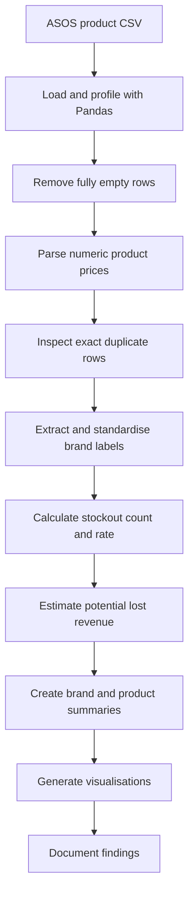

# ASOS Product Stockout & Lost Revenue Analysis

A Python data analytics project based on the ASOS product-listing notebook. The workflow profiles and cleans product data, converts prices to numeric values, extracts brand labels, measures out-of-stock sizes, estimates potential lost revenue, and creates summary tables and charts.

> **Data note:** The source CSV (`products_asos.csv`) was not included in the supplied PDF. Add an authorised copy locally to `data/raw/products_asos.csv` before running the pipeline. Generated data and outputs are excluded from version control.

## High-level architecture



## Repository structure

```text
ASOS-Product-Stockout-Analysis/
├── README.md
├── requirements.txt
├── .gitignore
├── data/
│   ├── README.md
│   ├── raw/                 # Place products_asos.csv here (not committed)
│   └── processed/           # Generated cleaned/enriched data (not committed)
├── src/
│   ├── clean_data.py
│   ├── extract_brands.py
│   ├── analyze_stockouts.py
│   ├── create_visualizations.py
│   └── run_pipeline.py
├── Docs/
│   ├── project_overview.md
│   ├── data_dictionary.md
│   ├── methodology.md
│   └── findings.md
└── outputs/                 # CSV summaries and charts (not committed)
```

## Business questions

- Which brands have the most product listings in this dataset?
- How many sizes are marked `Out of stock` for each product?
- What is each product's stockout rate across the listed size entries?
- Which products have the highest **estimated** lost revenue under the notebook's price-times-stockout-count measure?

## Tools

Python, Pandas, Matplotlib, and Seaborn.

## Run the project

1. Install dependencies:

   ```bash
   pip install -r requirements.txt
   ```

2. Place the CSV at `data/raw/products_asos.csv`.
3. Run the full workflow from the repository root:

   ```bash
   python src/run_pipeline.py
   ```

You can also run scripts individually in this order: `clean_data.py`, `extract_brands.py`, `analyze_stockouts.py`, then `create_visualizations.py`.

## Findings reported in the supplied notebook PDF

- Initial DataFrame: **9,875 rows and 9 columns**.
- After removing fully empty rows: **9,857 rows and 9 columns**.
- Exact duplicate rows detected: **5**. The notebook displayed these duplicates but did not show a deduplication step.
- The `price` field was converted from object/string values (including formats such as `From 42.50` and `Now 72.00`) to numeric values.
- Reported top five brands by product listing count: ASOS (2,970), Topshop (597), River Island (304), Miss Selfridge (301), and New Look (254).

The figures above are reported in the supplied notebook export.

